# BridgeDrop 説明書

BridgeDropは、**パソコンとスマホの間で、写真やファイルを受け渡しするアプリ**です。ケーブルも、インターネット上の保管サービスも使いません。

パソコンにアプリを入れて、スマホでQRコードを読み取るだけで使えます。スマホにアプリを入れる必要はありません。

## もくじ

1. [必要なもの](#1-必要なもの)
2. [ダウンロードする](#2-ダウンロードする)
3. [パソコンに置いて、起動する（Windows）](#3-パソコンに置いて起動するwindows)
4. [パソコンに置いて、起動する（Mac）](#4-パソコンに置いて起動するmac)
5. [スマホとつなぐ](#5-スマホとつなぐ)
6. [ファイルを送る・受け取る](#6-ファイルを送る受け取る)
7. [まとめて保存・削除する](#7-まとめて保存削除する)
8. [終了する](#8-終了する)
9. [困ったときは](#9-困ったときは)
10. [安全に使うために](#10-安全に使うために)
11. [新しい版に入れ替える・削除する](#11-新しい版に入れ替える削除する)

---

## 1. 必要なもの

| 必要なもの | 内容 |
|---|---|
| パソコン | Windows 10 / 11、またはApple製チップ（M1以降）のMac |
| スマホ | iPhone、iPad、Androidのいずれか。QRコードが読めるカメラ付き |
| つなぐ環境 | パソコンとスマホが同じWi-Fi（ルーター）につながっていること |

ルーターがない場所でも、Windowsならパソコンから直接つなげます。[5-2](#5-2-ルーターがない場所でつなぐ) を見てください。

> **Macについて:** Mac版は試験中です。動作確認が十分ではないので、うまく動かないことがあります。

---

## 2. ダウンロードする

ここでは、パソコンで作業します。

**1.** パソコンのブラウザで、次のページを開きます。

<https://github.com/nobuCreator/BridgeDrop/releases/latest>

GitHubのアカウントがなくても、ダウンロードできます。

**2.** ページの下の方にある **Assets** の中から、**お使いのパソコンに合うファイルを1つだけ**クリックします。

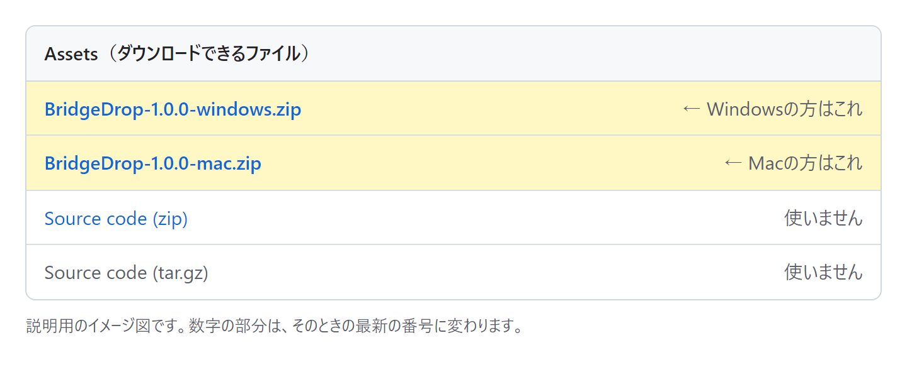

| お使いのパソコン | ダウンロードするファイル |
|---|---|
| Windows | `BridgeDrop-(番号)-windows.zip` |
| Mac | `BridgeDrop-(番号)-mac.zip` |

**Source code** と書かれたものは、開発者向けです。ダウンロードしないでください。

**3.** ダウンロードしたファイルは、ふつうは **ダウンロード** フォルダに入っています。

---

## 3. パソコンに置いて、起動する（Windows）

Macの方は [4](#4-パソコンに置いて起動するmac) へ進んでください。

### 3-1. ZIPファイルを展開する

ダウンロードしたファイルは圧縮されているので、そのままでは使えません。

1. エクスプローラーで **ダウンロード** フォルダを開きます。
2. `BridgeDrop-(番号)-windows.zip` を **右クリック** します。
3. **「すべて展開」** を選び、**「展開」** を押します。

`BridgeDrop-(番号)-windows` というフォルダができて、その中に **`BridgeDrop`** フォルダがあります。

### 3-2. 好きな場所へ移す

**`BridgeDrop` フォルダを丸ごと**、**ドキュメント** など、消さない場所へ移します。

> **大事:** 中の `BridgeDrop.exe` だけを取り出さないでください。同じフォルダの `_internal` がないと動きません。

### 3-3. 起動する

`BridgeDrop` フォルダの中の **`BridgeDrop.exe`** をダブルクリックします。

毎回フォルダを開くのが面倒なときは、`BridgeDrop.exe` を右クリックして **「ショートカットの作成」** を選び、できたショートカットをデスクトップへ移すと便利です。

### 3-4. 初めて起動するときの確認画面

初回だけ、次の画面が出ることがあります。

**「WindowsによってPCが保護されました」と出たとき**

このアプリには、配布元を証明する有料の署名が付いていないため、この画面が出ます。

1. **「詳細情報」** を押します。
2. **「実行」** を押します。

**「Windowsセキュリティの重要な警告」（ファイアウォール）が出たとき**

スマホからパソコンへつなぐために必要な許可です。

1. **「プライベート ネットワーク」** と **「パブリック ネットワーク」** の両方にチェックを入れます。
2. **「アクセスを許可する」** を押します。

ここで許可しないと、スマホからつながりません。

BridgeDropの画面が開けば、起動は完了です。 [5](#5-スマホとつなぐ) へ進んでください。

---

## 4. パソコンに置いて、起動する（Mac）

### 4-1. アプリケーションフォルダへ移す

1. Finderで **ダウンロード** フォルダを開きます。
2. `BridgeDrop-(番号)-mac.zip` をダブルクリックすると、**`BridgeDrop`** アプリができます。
3. **`BridgeDrop`** を **アプリケーション** フォルダへドラッグします。

### 4-2. 初めて起動する

このアプリには、Appleの署名が付いていません。そのため、最初の起動だけ手順が必要です。

1. アプリケーションフォルダの **`BridgeDrop`** をダブルクリックします。開けないというメッセージが出たら、閉じます。
2. **システム設定** の **プライバシーとセキュリティ** を開きます。
3. 下の方にあるBridgeDropの項目で **「このまま開く」** を押します。
4. 確認の画面でも **「開く」** を押します。

次回からは、ダブルクリックだけで開けます。

ネットワークへの接続を確認する画面が出たら、**「許可」** を押します。

---

## 5. スマホとつなぐ

BridgeDropを起動すると、パソコンにこの画面が出ます。**「端末をつなぐ」** を押すと、つなぎ方が表示されます。

### 5-1. 同じWi-Fiでつなぐ

自宅や職場など、ふだんはこの方法を使います。

1. スマホを、パソコンと同じWi-Fiにつなぎます。
2. パソコンの画面で **「同じネットワーク」** を押します。
3. スマホのカメラで、**QRコードを読み取ります**。
4. 表示された通知やリンクを押すと、BridgeDropが開きます。

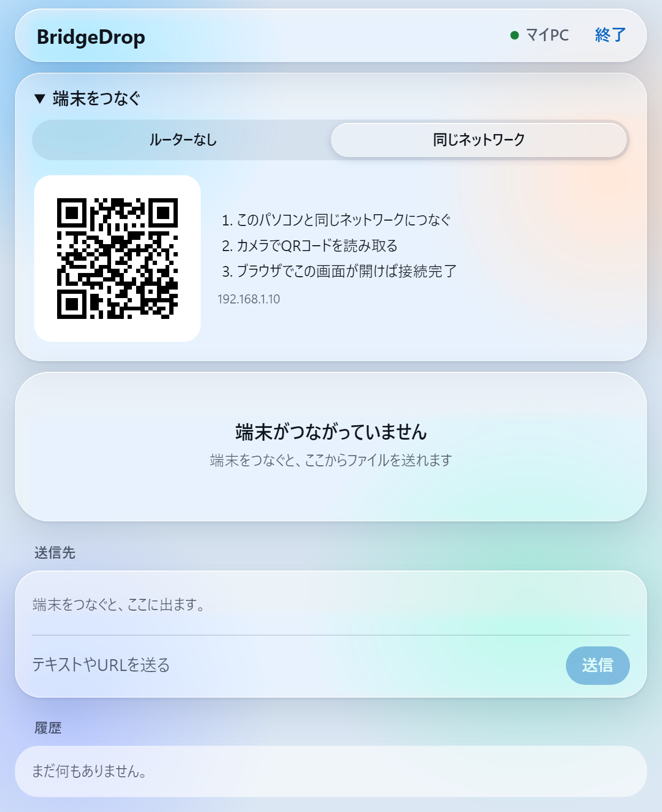

つながると、スマホに次のような画面が出ます。

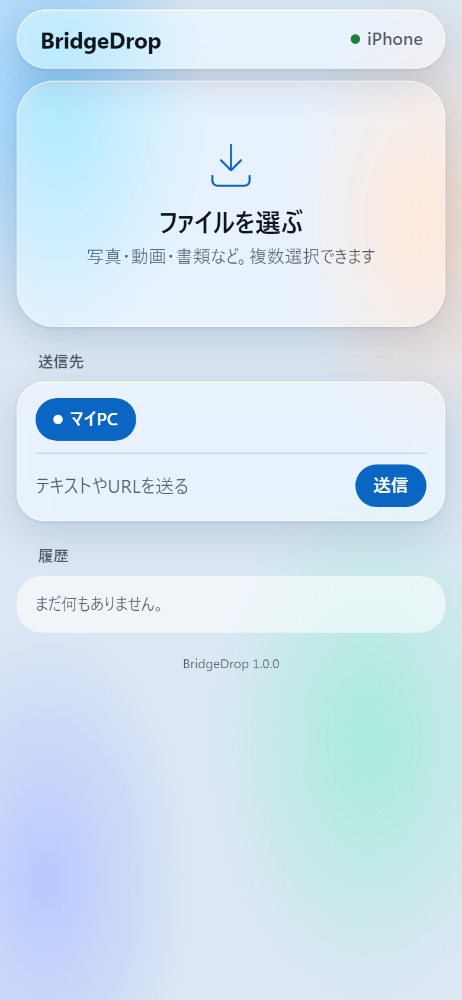

**次回からQRコードなしで開くには:** スマホでBridgeDropを開いたまま、ブラウザのメニューから **「ホーム画面に追加」** を選びます。

### 5-2. ルーターがない場所でつなぐ

**Windowsの場合**

パソコンがインターネットにつながっていれば、パソコンのWi-Fiから直接つなげます。パソコンのWi-Fiをオンにしておいてください。

1. パソコンの画面で **「ルーターなし」** を押します。
2. **「直接接続を開始」** を押します。

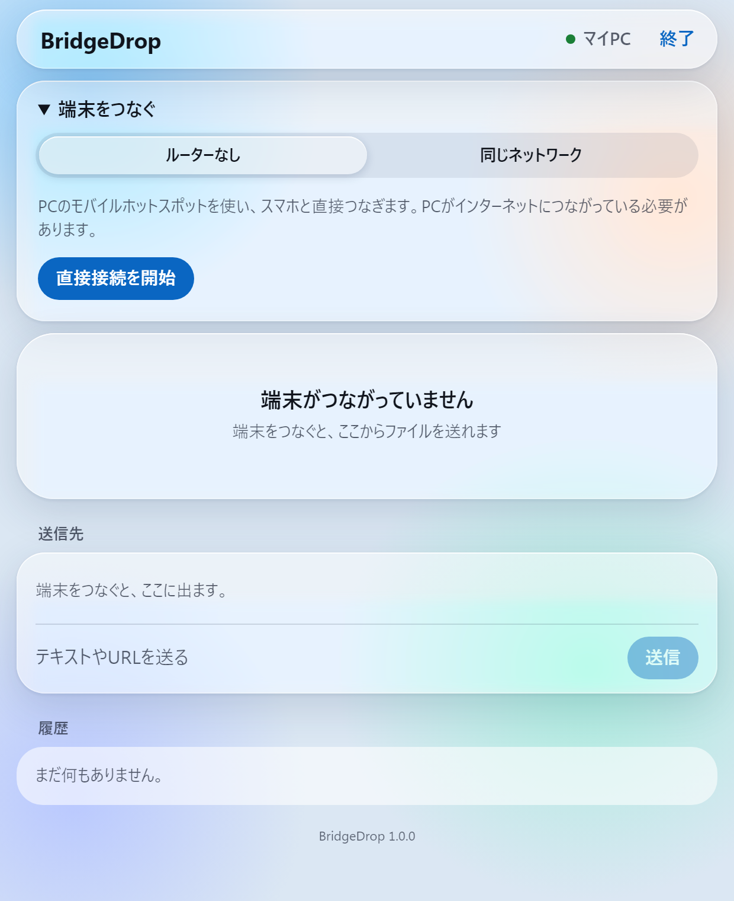

3. 表示されたQRコードをスマホで読み取り、そのWi-Fiに接続します。

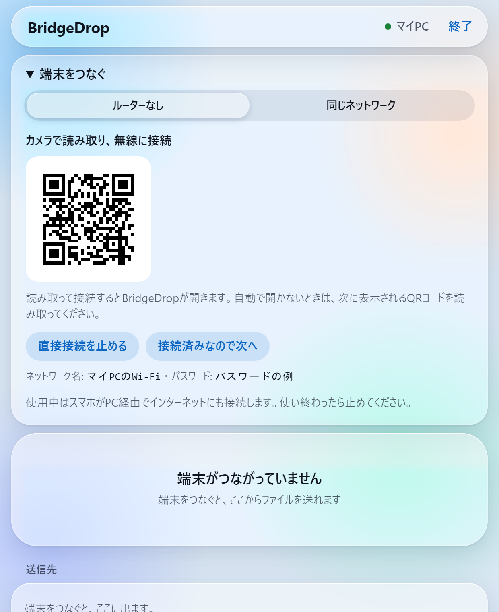

4. BridgeDropが自動で開きます。開かないときは、パソコンの画面に次のQRコードが出るので、スマホのカメラで読み取ります。

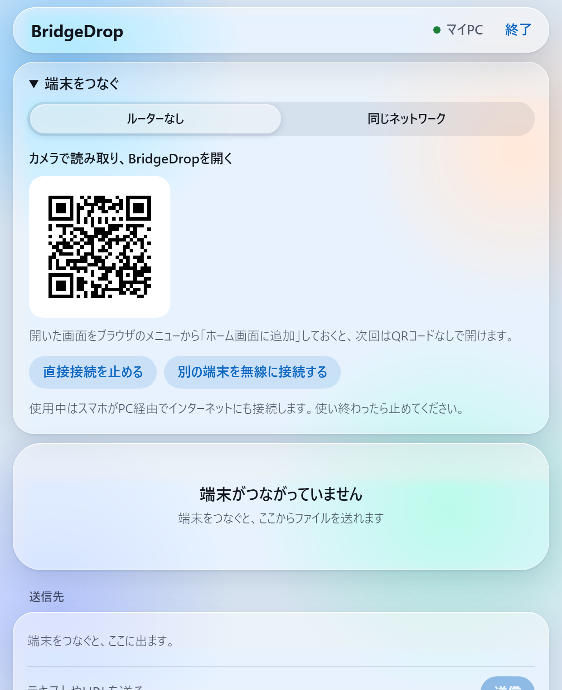

iPhoneでは、小さな画面でBridgeDropが開くことがあります。Safariと重なって「完了で閉じてください」と出たら、右上の **「完了」** を押してください。

使い終わったら、**「直接接続を止める」** を押してください。

**Macの場合**

スマホのテザリング（インターネット共有）をオンにして、Macをそのネットワークにつなぎます。そのあと、[5-1](#5-1-同じwi-fiでつなぐ) と同じ手順でQRコードを読み取ります。

---

## 6. ファイルを送る・受け取る

スマホがつながると、パソコンの画面はこのように変わります。**「送信先」** にスマホの名前が出ていれば、準備完了です。

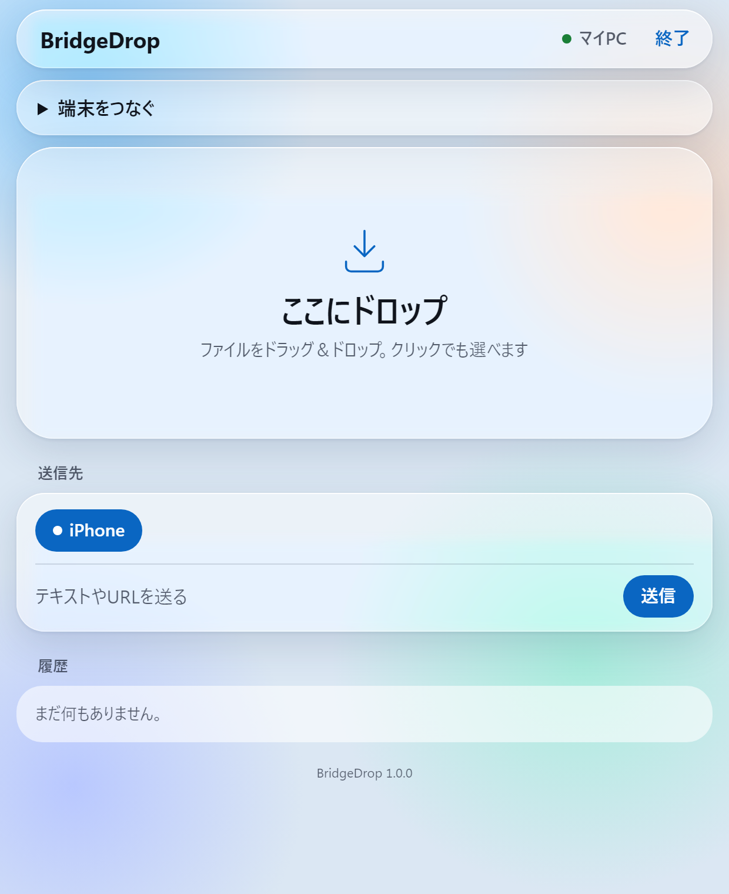

### パソコンからスマホへ送る

1. **スマホでBridgeDropの画面を開いたまま**にします。
2. パソコンの **「ここにドロップ」** へファイルをドラッグします。クリックして選ぶこともできます。
3. スマホの **「履歴」** に届いたら、**「保存」** を押します。

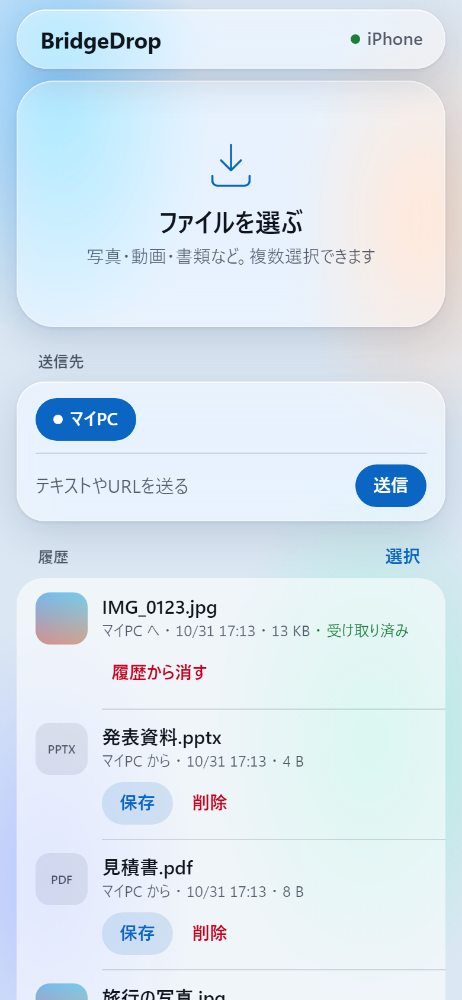

**写真を写真アプリに入れるには（iPhone）**

**「写真に保存」** を押して、開いた画像を長押しし、**「写真に保存」** を選びます。終わったら **「BridgeDropに戻る」** を押します。

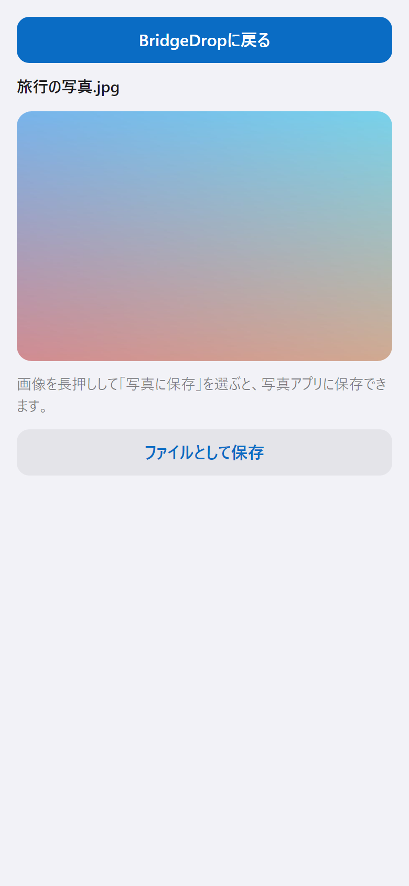

Androidでは、画像を長押しして **「画像をダウンロード」** を選びます。

**動画を写真アプリに入れるには（iPhone）**

「保存」で保存したあと、「ファイル」アプリで動画を開き、共有メニューから **「ビデオを保存」** を選びます。

### スマホからパソコンへ送る

- **iPhone:** **「ファイルを選ぶ」** を押して、写真やファイルを選びます。
- **Android:** **「写真・動画」** か **「ファイル」** を押して選びます。

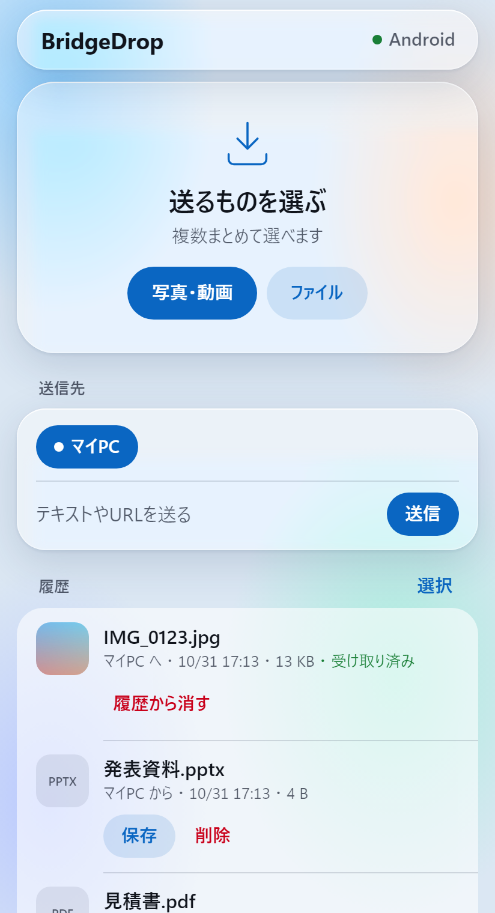

届いたファイルは、パソコンの **ダウンロード** フォルダの中の **`BridgeDrop`** フォルダに保存されます。履歴の **「フォルダで表示」** を押すと、その場所が開きます。

### テキストやURLを送る

**「テキストやURLを送る」** の欄に入力して、**「送信」** を押します。受け取った側は **「コピー」** で使えます。

### 覚えておくこと

- **スマホ側は画面を開いておきます。** 別のアプリに切り替えたり画面を消したりすると、送信先から消えます。画面に戻ると、また表示されます。
- **受け取っていないファイルは消えます。** パソコンからスマホへ送ったファイルは、24時間たつか、BridgeDropを終了すると消えます。パソコンに保存済みのファイルは消えません。
- **フォルダはそのまま送れません。** 圧縮してZIPにするか、中のファイルを選んでください。

---

## 7. まとめて保存・削除する

1. **「履歴」** の右にある **「選択」** を押します。
2. 保存または削除したいものを押して選びます。
3. 下のバーで **「保存」** か **「削除」** を押します。
4. 終わったら **「完了」** を押します。

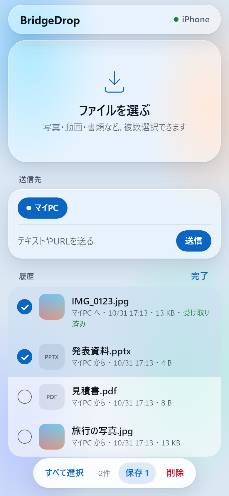

2件以上を保存すると、1つのZIPファイルにまとめて保存します。ZIPは、スマホのファイルを管理するアプリから開けます。

写真アプリに入れたいときは、1枚ずつ「写真に保存」を使ってください。

---

## 8. 終了する

画面右上の **「終了」** を押して、確認画面でもう一度 **「終了」** を押します。

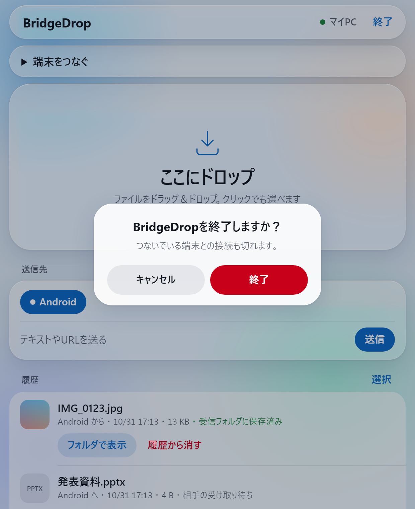

BridgeDropのウィンドウを閉じても、しばらくすると終了します。ファイルを送っている途中で閉じると、送信が止まるので注意してください。

---

## 9. 困ったときは

| 困っていること | 確かめること |
|---|---|
| QRコードを読んでも開けない | パソコンとスマホが同じWi-Fiか確認してください。ゲスト用のWi-Fiだとつながらないことがあります |
| 「このサイトにアクセスできません」と出る | パソコンのBridgeDropが起動しているか確認してください。パソコンのファイアウォールで許可されていない可能性もあります（下の項目） |
| ファイアウォールの許可をし忘れた | Windowsの「ファイアウォールによるアプリケーションの許可」でBridgeDropにチェックを入れるか、BridgeDropの項目を見直してください |
| 「端末がつながっていません」のまま | スマホでBridgeDropの画面を開いてください。別のアプリを開いていると、つながっていない扱いになります |
| 前は開けたアイコンから開けない | パソコンのアドレスが変わった可能性があります。QRコードを読み取り直してください |
| 「無線を開始できませんでした」と出る | パソコンのWi-Fiがオンか確認してください。「ルーターなし」にはパソコンのインターネット接続も必要です |
| iPhoneで「保存」を押してもSafariが開くだけ | 簡易画面では保存できないので、Safariへ移ります。開いたSafariの画面で保存を続けてください |
| Androidでアルバムが出ない | **「写真・動画」** のボタンから選んでください |
| ダウンロードで警告が出る | この接続が暗号化されていないために出ます。自分のパソコンから送ったファイルなら、許可して保存してかまいません |

---

## 10. 安全に使うために

- **自宅など、信頼できるWi-Fiで使ってください。** 同じWi-Fiでの通信は暗号化されません。カフェや駅などの公共Wi-Fiでは使わないでください。
- **QRコードやアドレスを人に教えないでください。** 接続に必要な情報が入っています。知っている人は、同じネットワークからBridgeDropを開けます。
- **「ルーターなし」の無線のパスワードも同じです。** 使用中は、つないだ端末がパソコン経由でインターネットも使えるようになります。使い終わったら止めてください。
- **使わないときは終了してください。**

ファイルはインターネットを通らず、パソコンとスマホの間だけでやり取りします。

---

## 11. 新しい版に入れ替える・削除する

使っている版の番号は、画面のいちばん下に小さく書いてあります。

### 新しい版に入れ替える

1. BridgeDropを終了します。
2. [2](#2-ダウンロードする) と同じ手順で、新しいファイルをダウンロードします。
3. 古い `BridgeDrop` フォルダ（Macは `BridgeDrop` アプリ）を削除して、新しいものに置き換えます。

受信したファイルや接続の設定は、別の場所にあるので消えません。

### パソコンから削除する

1. BridgeDropを終了します。
2. `BridgeDrop` フォルダ（Macは `BridgeDrop` アプリ）を削除します。
3. 接続の設定も消すときは、ホームフォルダの中の `.bridgedrop` フォルダを削除します。Windowsの場合は `C:\Users\(ユーザー名)\.bridgedrop` です。

受信したファイルは **ダウンロード** フォルダの **`BridgeDrop`** に残るので、いらなければ削除してください。
